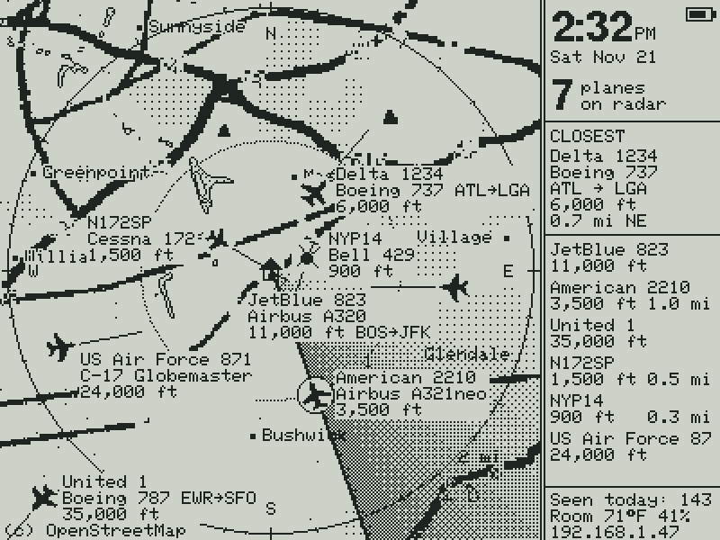
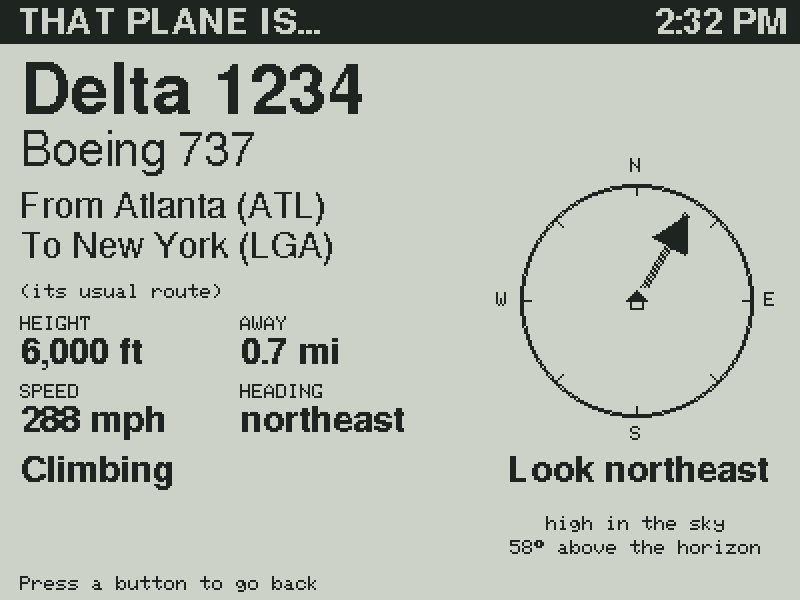
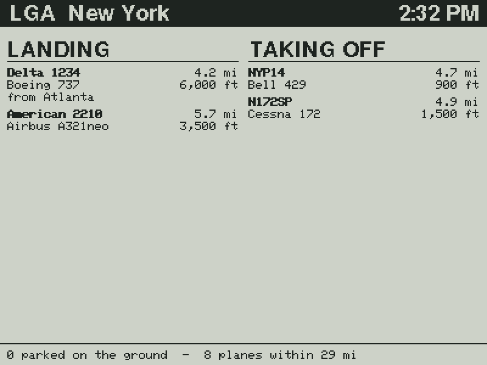
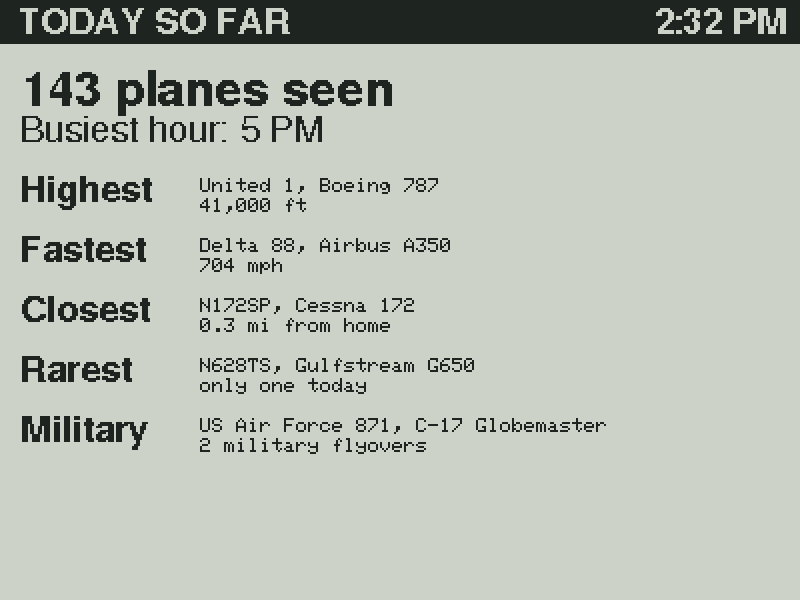
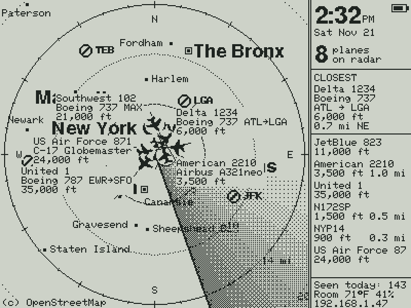
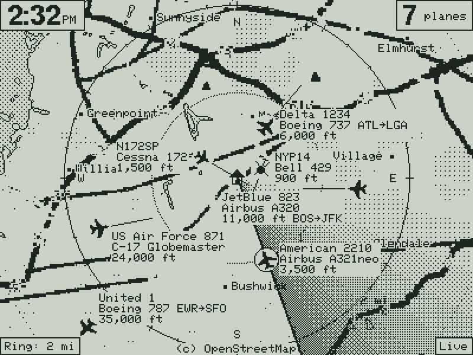
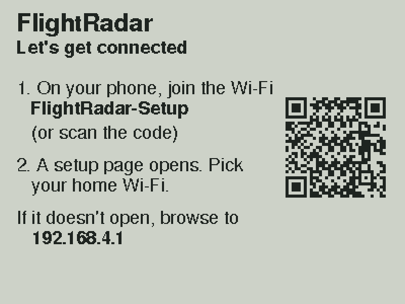
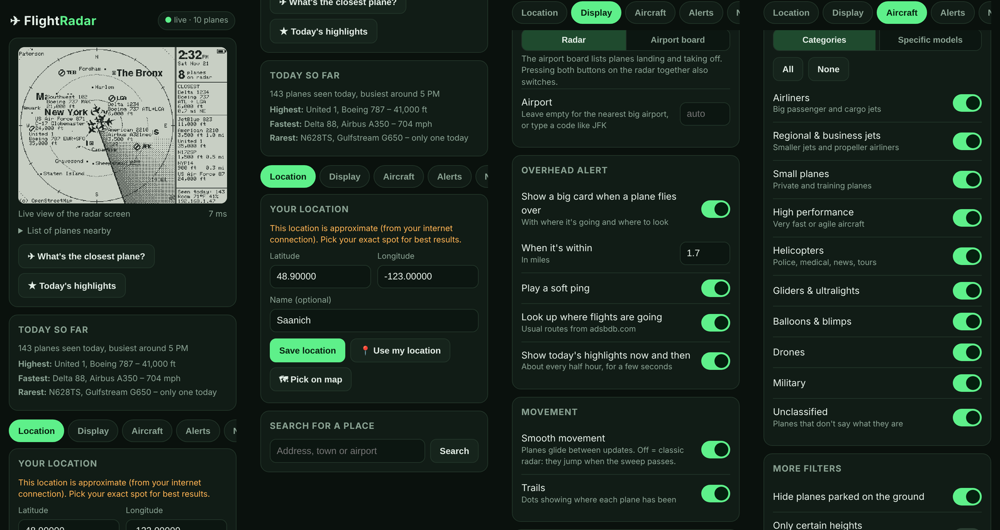

# ✈ Tabletop Flight Dashboard

**A little radar for your table that shows the planes flying over your home — live.**

Built for the [Waveshare ESP32-S3-RLCD-4.2](https://github.com/waveshareteam/ESP32-S3-RLCD-4.2), a 4.2″ reflective black-and-white screen that reads like paper. Plug it in, join it to Wi-Fi from your phone, and it draws a street map of your area with a spinning radar sweep and every plane nearby: what flight it is, what kind of plane, how high it's flying and where it's headed. Everything is set up from a web page the radar hosts itself. You don't need an app, an account or any aviation knowledge.

<p align="center">
  
</p>

---

## Contents

- [Features](#features)
- [Screens](#screens)
- [The settings page](#the-settings-page)
- [What you need](#what-you-need)
- [Getting started](#getting-started)
  - [1. Put the firmware on the board](#1-put-the-firmware-on-the-board)
  - [2. Connect it to Wi-Fi](#2-connect-it-to-wi-fi)
  - [3. Set your location](#3-set-your-location)
- [Using it](#using-it)
  - [Buttons](#buttons)
  - [Reading the screen](#reading-the-screen)
- [Updates](#updates)
- [Building from source](#building-from-source)
- [Project layout](#project-layout)
- [Troubleshooting](#troubleshooting)
- [Data sources and credits](#data-sources-and-credits)

---

## Features

| | |
|---|---|
| 🛰 **Live radar** | A spinning sweep over a black-and-white street map. Planes glide smoothly between updates and leave a dotted trail. |
| 🏷 **Plain-English labels** | "Delta 1234 · Boeing 737 · 6,000 ft · ATL→LGA" instead of "DAL1234 B739". Feet and mph by default; pilot (knots) and metric units available. |
| 🛬 **Where flights are going** | Usual routes from adsbdb.com, shown on labels, in the side panel and on the overhead card. |
| 🔔 **Overhead card** | When a plane passes close, a full-screen card shows the flight, the plane, its route, height and speed, and **which way to look up**. An optional soft ping plays. |
| 🗺 **Street map with names** | Roads, water, parks, town names and airports with their codes (JFK, LGA…). Drawn once per location and zoom level, then saved on the board. |
| 🏢 **Airport board** | Planes landing at and taking off from the nearest big airport, or one you choose. |
| ⭐ **Today's highlights** | Highest, fastest, closest and rarest plane, military flyovers and the busiest hour. |
| 🎛 **Filters** | By kind of aircraft (airliners, helicopters, small planes, military…), by specific models, by altitude or by airline. |
| 🚨 **Alerts** | Optional banner and chime for emergencies, military aircraft, helicopters, chosen models or anything passing close by. |
| 🌙 **Night mode** | Calm the display or switch it off overnight. |
| 🔄 **Self-updating** | Installs new releases from this repository on its own. A watchdog restarts it if anything ever freezes. |
| 🌡 **Board extras** | Room temperature and humidity, a battery gauge when an 18650 is fitted, and a clock chip that keeps time through internet outages. |

## Screens

<table>
  <tr>
    <td width="50%"><br><b>Overhead card</b> — appears when a plane flies close: flight, model, route, height, speed and a compass showing where to look.</td>
    <td width="50%"><br><b>Airport board</b> — planes landing and taking off. Press both buttons to switch to it.</td>
  </tr>
  <tr>
    <td><br><b>Today's highlights</b> — shown every half hour or so, and on the settings page.</td>
    <td><br><b>Map labels</b> — town names (big cities in bold) and airports with their codes.</td>
  </tr>
  <tr>
    <td><br><b>Full-screen layout</b> — the radar without the side panel; clock and count in the corners.</td>
    <td><br><b>First start</b> — join the radar's own Wi-Fi (or scan the code) to set it up.</td>
  </tr>
</table>

> The screenshots are renders from the firmware's drawing code with sample planes over New York. The real screen is a reflective LCD: dark ink on a pale grey-green background, best in daylight or lamplight.

## The settings page

Open **http://flightradar.local** (or the address shown on the screen) from any phone or computer on the same Wi-Fi. It includes a live copy of the radar screen, a list of the planes nearby with links to track them, and today's highlights.

<p align="center">
  
</p>

| Tab | What's there |
|---|---|
| **Location** | Search an address, pick the spot on a map, or type coordinates. |
| **Display** | Radar or airport board, how far to look, units, labels, overhead card, smooth movement, trails, map style, room temperature. |
| **Aircraft** | Filters by kind of aircraft and by model (grouped by manufacturer, with *All* buttons), plus height, airline and emergency options. |
| **Alerts** | Banner and chime for emergencies, military, helicopters, chosen models or close passes. |
| **Night** | Calm or switch off the screen between set hours. |
| **Help** | How to read the screen, what the buttons do, typical altitudes. |
| **System** | Status, time zone, updates, restart, factory reset, and an *Advanced* section (data source, refresh rate, device name, manual firmware upload). |

## What you need

- **Waveshare ESP32-S3-RLCD-4.2** (ESP32-S3 with 16 MB flash and 8 MB PSRAM, 400×300 reflective LCD, speaker, two buttons).
- A **USB-A to USB-C cable** and a wall charger. Some USB-C-to-C cables won't power the board.
- A **2.4 GHz** Wi-Fi network with internet access. The ESP32 can't use 5 GHz.
- Optional: an **18650 battery** for cordless use, and the small **rechargeable backup battery** for the clock chip.

## Getting started

### 1. Put the firmware on the board

The first install is over USB; later versions arrive over Wi-Fi.

**Easiest — from the browser:**
1. Download `flightradar-full.bin` from the latest [release](../../releases/latest).
2. In **Chrome** or **Edge** (Safari can't do this), open the [Adafruit WebSerial ESPTool](https://adafruit.github.io/Adafruit_WebSerial_ESPTool/).
3. Click **Connect** and choose the board's port.
   - If it isn't listed, hold **BOOT**, click **PWR** (or re-plug the cable), then let go of BOOT.
4. Set the first offset to `0`, choose the file, and click **Program**.
5. When it finishes, press **PWR** or re-plug the board.

**With PlatformIO:** see [Building from source](#building-from-source), then run `pio run -t upload`.

### 2. Connect it to Wi-Fi

1. The screen shows **"Let's get connected"** with a QR code.
2. On your phone, join the Wi-Fi network **FlightRadar-Setup** (or scan the code).
3. A setup page opens (if it doesn't, go to `192.168.4.1`). Pick your home network and enter its password.
4. Switch your phone back to your home Wi-Fi.

### 3. Set your location

The radar guesses a rough location from your internet connection, so planes appear straight away. For an exact position, open **http://flightradar.local** → **Location**, then search your address or tap **Pick on map**.

## Using it

### Buttons

| Button | Press | Hold |
|---|---|---|
| **KEY** | Zoom in | 2 s: show the settings address and QR code · 10 s: factory reset |
| **BOOT** | Zoom out | 1.5 s: hide or show plane labels |
| **KEY + BOOT** together | Switch between the radar and the airport board | |
| **PWR** | Turn on | Turn off |

When a full-screen card is showing, any button closes it.

### Reading the screen

- **The little house** in the middle is home. The **solid ring** is the distance you chose; dotted rings are in between.
- **Plane and helicopter icons** point the way they're flying. The short line ahead shows roughly where they'll be in a minute; the **dots behind** are their trail.
- Each **label** shows the flight ("Delta 1234"), the plane ("Boeing 737"), the height, and the route when known. Private planes show their registration (e.g. N172SP) instead.
- The **side panel** has the clock, how many planes are on screen, the **closest** one in detail, the next nearest, how many were **seen today**, and the room temperature.
- A **ringed circle with a code** marks an airport (JFK, LGA…). Towns have a dot and their name.

Typical heights: airliners cruise at 30,000–40,000 ft, climb and descend near airports, and small planes and helicopters stay below about 10,000 ft.

## Updates

**Automatic:** radars check this repository's [latest release](../../releases/latest) once a day and install anything newer, showing *"Updating the radar… please don't unplug it"* while they do. To turn this off, or to check right away, use **System → Updates** on the settings page.

**Manual:** download `firmware.bin` from a release, then go to **System → Advanced → Firmware update** on the settings page. Settings, Wi-Fi and location are kept.

**Publishing a new version** (for the maintainer):
1. Change `FW_VERSION` in [`src/config.h`](src/config.h), for example to `"1.3.1"`.
2. Commit, tag and push:
   ```sh
   git commit -am "v1.3.1"
   git tag v1.3.1
   git push --follow-tags
   ```
3. [GitHub Actions](.github/workflows/release.yml) builds the firmware and publishes a release with `firmware.bin` (for wireless updates) and `flightradar-full.bin` (for USB). The tag must match `FW_VERSION`.

The repository must stay **public** so radars can download releases without a password.

## Building from source

1. Install [VS Code](https://code.visualstudio.com/) with the **PlatformIO IDE** extension, or the command line: `pip install platformio`.
2. Clone this repository and open the folder.
3. Build and flash over USB:
   ```sh
   pio run -t upload        # build + flash
   pio device monitor       # watch the logs
   ```
4. Or update a radar over Wi-Fi: `pio run -e rlcd42-ota -t upload`.

The toolchain is pinned to [pioarduino](https://github.com/pioarduino/platform-espressif32) 55.03.x (Arduino-ESP32 3.3), which the board's display code needs. The first build downloads it automatically.

## Project layout

```
├── platformio.ini            build settings (board, partitions, libraries)
├── partitions.csv            16 MB flash: two app slots for updates + storage
├── src/
│   ├── main.cpp              start-up, buttons, watchdog
│   ├── ui.cpp                everything drawn on the screen
│   ├── display.cpp           ST7305 reflective LCD driver
│   ├── flights.cpp           live plane data, filters, alerts, "seen today"
│   ├── routes.cpp            flight routes from adsbdb.com (cached)
│   ├── highlights.cpp        today's highlights
│   ├── basemap.cpp           OpenStreetMap tiles → black-and-white map + labels
│   ├── net.cpp               Wi-Fi setup hotspot, mDNS, clock sync, OTA
│   ├── web.cpp               settings page and its API
│   ├── updater.cpp           automatic updates from GitHub releases
│   ├── hw.cpp                clock chip, temperature sensor, battery
│   ├── audio.cpp             speaker chimes (ES8311)
│   ├── config.cpp            settings, saved in flash
│   ├── names.h, fmt.h        airline/plane names, friendly units
│   └── tz.h, airportdb.h     time zones, airport lookups
├── web/                      settings page + Wi-Fi setup page (built into the firmware)
├── data/                     built-in town and airport lists
├── tools/                    build helpers (web page embedding, place list generator)
├── docs/images/              screenshots for this README
└── .github/workflows/        release automation
```

## Troubleshooting

| Symptom | What to try |
|---|---|
| Nothing on the screen | The screen has no light of its own. Check it under a lamp, and press **PWR** once. |
| Board doesn't power on from a Mac/USB-C charger | Use a USB-A to USB-C cable (with an adapter if needed). |
| The Mac doesn't see the board | Try another cable — some only carry power. Then hold **BOOT**, press **PWR**, release BOOT. |
| "Can't reach your Wi-Fi" | Join **FlightRadar-Setup** on your phone and pick the network again. Use a 2.4 GHz network. |
| "Can't reach plane data yet" | The line underneath gives the reason. The radar switches between free data sources by itself; you can also pick one under *System → Advanced*. |
| Map says "Map unavailable" | OpenStreetMap was unreachable; it retries by itself. Planes still show without the map. |
| Settings page looks out of date after an update | Reload the page. |
| Start over completely | Hold **KEY** for 10 seconds, or use *System → Factory reset*. |

## Data sources and credits

- **Aircraft positions:** [adsb.lol](https://adsb.lol) and [adsb.fi](https://adsb.fi) — free community networks of ADS-B receivers.
- **Flight routes:** [adsbdb.com](https://www.adsbdb.com) — usual route per callsign.
- **Map:** © [OpenStreetMap](https://www.openstreetmap.org/copyright) contributors, converted to black and white on the device.
- **Town names:** [GeoNames](https://www.geonames.org) (CC BY 4.0), via the `geonamescache` package.
- **Airports:** [OurAirports](https://ourairports.com/data/) (public domain).
- **Display init sequence and board pinout:** [Waveshare ESP32-S3-RLCD-4.2 examples](https://github.com/waveshareteam/ESP32-S3-RLCD-4.2).
- **Libraries:** ArduinoJson, Adafruit GFX, PNGdec, QRCode, Leaflet (settings page map).
